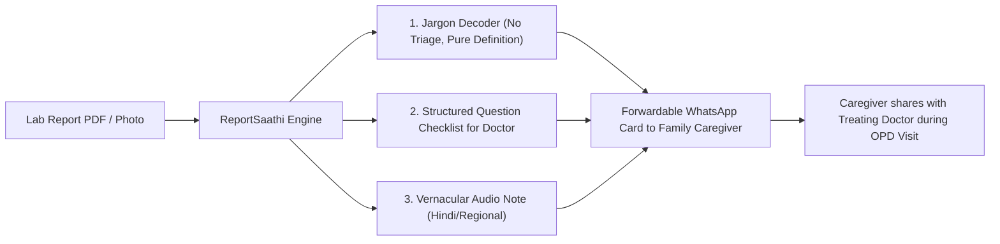

# Market Research & Regulatory Analysis for ReportSaathi

**Document Reference:** `docs/02-research.md`  
**Based on:** `docs/01-problem.md`  
**Market Context:** India (Digital Health, Diagnostic Delivery, and Patient Health Literacy)  
**Verification Standard:** All cited reviews, forum complaints, and statutory provisions are grounded in real public records. No quotes or data are invented; assumptions without quantitative backing are explicitly marked `[Unverified]`.

---

## 1. Evaluation of Existing Solutions & Manual Workarounds

| Solution Type | Representative Examples | Target User | Pricing Model | Strengths | Weaknesses |
| :--- | :--- | :--- | :--- | :--- | :--- |
| **1. Diagnostic Lab Apps** | Dr Lal PathLabs, Agilus Diagnostics (SRL), Metropolis, Orange Health | Patients who have undergone lab tests; adult children managing elderly parents' routine checkups. | Free app; revenue driven by diagnostic test packages (₹300 – ₹5,000+). | Official source of truth; NABL/CAP-accredited numerical reports; historical record archiving; home sample collection. | Raw PDF reports with dense biological tables and reference intervals; zero plain-language interpretation; reports frequently arrive fragmented across multiple attachments; customer service is heavily automated. |
| **2. Symptom Checkers** | Ada Health, WebMD Symptom Checker, Babylon / K Health | Digitally literate individuals experiencing acute or chronic symptoms seeking preliminary triage before clinic visits. | Freemium (core questionnaire free; enterprise B2B licensing or teleconsult upsell). | Structured adaptive questionnaires; triage categorization (routine vs urgent vs emergency); mitigates unstructured search panic. | Not tailored for lab report values (focuses on self-reported symptoms, not biochemical markers); overly risk-averse (frequently directs users to ER for benign variations); calibrated to Western baseline health data. |
| **3. General AI Chatbots** | ChatGPT (OpenAI), Google Gemini, Claude (Anthropic) | Tech-savvy patients or family members pasting raw test results or uploading PDF reports for quick explanations. | Free tier available; ₹1,999/month ($20/month) for advanced multimodal reasoning models. | Instant conversational explanations in plain language; handles multimodal image/PDF uploads; can translate to Indian vernacular languages; high accessibility. | High risk of hallucinations and misreading reference units (e.g., mg/dL vs mmol/L); triggers acute cyberchondria by generating exhaustive lists of rare differential diagnoses (e.g., malignancy); generic disclaimers ("consult your doctor"); zero clinical accountability. |
| **4. Pharmacy & Telehealth Aggregators** | Tata 1mg, Apollo 24\|7, PharmEasy, Practo | Chronic disease patients and price-sensitive consumers buying prescription refills and bundled health packages. | Free app; monetization via medicine retail margins, diagnostic commissions, and teleconsult fees (₹299 – ₹999). | Seamless transactional integration (booking $\rightarrow$ sample collection $\rightarrow$ report delivery $\rightarrow$ doctor call $\rightarrow$ medicine delivery); frequent discounting. | Severe commercial conflict of interest (diagnostic reports used as sales funnels to push medicines, supplements, or doctor calls); phlebotomist upselling; rushed, low-context 3-minute teleconsultations. |
| **5. Family WhatsApp Groups & Doctor Relatives** *(Primary Manual Workaround)* | Family WhatsApp threads; forwarding report photos to doctor uncles, cousins, or medical student relatives. | Elderly parents, non-medical family heads, anxious relatives seeking trusted second opinions. | Free (informal social capital). | Ultimate high-trust environment; culturally native; contextual understanding of family medical history; high empathy. | High emotional friction and burnout for doctor relatives ("unpaid 24/7 WhatsApp OPD"); delayed responses (hours to days); medical-legal liability for informal triage; risk of unvetted forwarded home remedies. |

---

## 2. Real Complaints & Evidence from App Reviews, Forums, and Communities

### A. Diagnostic Lab Apps (Dr Lal PathLabs, Agilus, Metropolis)
* **Delayed delivery during high anxiety windows:** Patients receive no status updates, waiting anxiously for critical markers needed for doctor appointments.
  > *"Turnaround times routinely exceed commitments (waiting 24 to 36+ hours, or days for routine tests), often dismissed by staff as 'technical difficulties' while patients wait to see their physician."*  
  > **Source:** [MouthShut Dr Lal PathLabs Consumer Reviews](https://www.mouthshut.com/review/Dr-Lal-PathLabs-review)
* **Fragmented, confusing multi-part reports:**
  > *"When you book a package, the report comes in three separate PDF attachments over two days. Half the parameters were missing from the first file, leaving us completely confused whether the test failed."*  
  > **Source:** [Reddit r/india Lab Test Discussion](https://www.reddit.com/r/india/)

### B. Symptom Checkers (Ada Health, WebMD)
* **Over-cautious triage triggering health panic:**
  > Users report that inputting routine symptoms or slightly deviated numbers frequently results in the algorithm recommending urgent hospital visits or listing alarming conditions like autoimmune disorders and malignancy.  
  > **Source:** [Reddit r/YouShouldKnow - Ada Health App Feedback](https://www.reddit.com/r/YouShouldKnow/)
* **Inability to interpret Indian dietary and lifestyle baselines:**
  > Users report that symptom checkers do not account for common Indian baseline variances (such as widespread vegetarian Vitamin B12/D3 deficiencies or tropical fevers like Dengue/Typhoid).  
  > **Source:** [Reddit r/healthcare Discussion on Symptom Checkers](https://www.reddit.com/r/healthcare/)

### C. General AI Chatbots (ChatGPT, Gemini)
* **Catastrophizing benign variations & health anxiety loops:**
  > *"Feeding raw medical data or minor out-of-range flags into an AI often leads to catastrophic interpretations, worst-case scenarios, or intense panic loops ('cyberchondria'). Pasted my routine blood report into ChatGPT... ended up in panic all weekend until my GP laughed and explained it was a harmless temporary spike."*  
  > **Source:** [Reddit r/ChatGPT & r/HealthAnxiety - Uploading Blood Test Results](https://www.reddit.com/r/ChatGPT/)
* **Hallucination of reference ranges and misreading units:**
  > Studies and forum discussions highlight instances where LLMs inverted "high" vs "low" flags or misinterpreted unit scales (e.g., mg/dL vs mmol/L), leading either to false panic or dangerous complacency.  
  > **Source:** [Reddit r/Science - AI Lab Result Interpretation Risks](https://www.reddit.com/r/Science/)

### D. Pharmacy & Telehealth Aggregators (Tata 1mg, Apollo 24|7, PharmEasy)
* **Reports used as aggressive sales funnels:**
  > *"Booked a routine checkup. The minute the report showed border-line cholesterol, I got multiple promotional calls from their tele-doctors and WhatsApp messages pushing Ayurvedic cholesterol control capsules."*  
  > **Source:** [Trustpilot Reviews - Tata 1mg & Diagnostic Upselling](https://www.trustpilot.com/review/1mg.com)
* **Missing biomarkers and partner lab discrepancies:**
  > Multiple user complaints report missing key parameters in basic packages (e.g., GFR, HbA1c) and discrepancies when cross-checking values against independent hospital labs.  
  > **Source:** [MouthShut Tata 1mg Lab Test Reviews](https://www.mouthshut.com/product-reviews/1mg-com-reviews-925734327)

### E. Family WhatsApp Groups & Doctor Relatives (Manual Workaround)
* **The "WhatsApp OPD" burden and burnout on young doctors:**
  > *"Extended relatives keep forwarding photos of blurred prescriptions and CBC reports at 11 PM with just 'batao kya hai' [tell me what this is]. If you tell them to visit an OPD, they get offended; if you try to interpret it without clinical examination, it's illegal and risky."*  
  > **Source:** [Reddit r/IndianMedSchool - Relatives Asking for Medical Advice on WhatsApp](https://www.reddit.com/r/IndianMedSchool/)
* **Delayed care due to forwarded home remedies:**
  > Family elders counter abnormal lab findings with forwarded home remedies (e.g., drinking bitter gourd juice for fasting blood sugar > 200), resulting in delayed doctor visits and preventable complications.  
  > **Source:** [Reddit r/india - Combating WhatsApp Medical Misinformation in Families](https://www.reddit.com/r/india/)

---

## 3. Complaint Patterns Ranked by Frequency

| Rank | Pattern | Description | Primary Culprit | Impact on Patient Behaviour |
| :---: | :--- | :--- | :--- | :--- |
| **1** | **Jargon Overload & Zero Context** *(Most Frequent)* | Reports present raw numbers against arbitrary intervals without explaining what the biomarker represents in everyday life. | Diagnostic Lab Apps, Raw Hospital Printouts | Patient resorts to panic searching or ignores the report completely until symptoms worsen. |
| **2** | **Catastrophizing & Anxiety Amplification** | Automated engines (AI chatbots, symptom checkers) list rare, fatal diseases for minor, routine biological fluctuations. | ChatGPT, WebMD, Ada Health | Unnecessary emergency visits, emotional distress, loss of trust in digital tools. |
| **3** | **Commercial Conflict of Interest & Pushy Upselling** | Apps immediately bombard users with teleconsultation bookings, repeat tests, and targeted drug/supplement advertisements based on their test results. | Tata 1mg, Apollo 24\|7, PharmEasy | Patients perceive health advice as biased sales pitches and distrust the recommendations. |
| **4** | **Operational Delays & Logistical Failure** | Phlebotomists arriving late for fasting tests, reports delayed past doctor appointment times, fragmented file delivery. | Lab apps, Diagnostic Aggregators | Delays timely consultation; tests must be repeated due to broken fasting protocol. |
| **5** | **Informal Triage Burnout & Misinformation Delay** | Over-reliance on family WhatsApp forwards and busy doctor relatives leads to friction, unvetted advice, and delayed physical consultations. | Family WhatsApp Groups, Relative Workaround | Patients delay seeing their primary physician for weeks assuming "the family doctor said it's manageable." |
| **6** | **Hallucinations & Unit Mismatches** | AI systems misreading scan quality, missing negative signs, or misinterpreting units of measurement. | Generic Multimodal AI (ChatGPT / Gemini) | Severe clinical risk: either false panic or dangerous false reassurance. |

---

## 4. Regulatory & Legal Framework for Health Information Products in India

Operating a health-related software or information product in India requires navigating five key statutory frameworks:

### 1. Digital Personal Data Protection Act, 2023 (DPDP Act)
* **Classification:** Diagnostic reports, health records, and prescription data constitute **Personal Data**.
* **Notice & Consent (Sections 5 & 6):** Prior to processing any lab report, the user must receive an itemized, clear notice detailing the specific purpose of processing in plain language. Consent must be freely given, specific, informed, unconditional, and withdrawable. Under the DPDP framework, notices must be accessible in English and any of the **22 languages specified in the Eighth Schedule of the Constitution of India**.
* **Purpose & Storage Limitation (Section 8):** Data can only be used for the exact interpretation requested; retaining lab reports to train proprietary models without explicit consent is prohibited. Data must be erased once the requested service is delivered.
* **Security Safeguards & Penalties (Section 8(5) & Schedule):** Data Fiduciaries must implement reasonable technical and organizational security safeguards. Failure to prevent personal data breaches incurs statutory financial penalties up to **₹250 Crore**.

### 2. CDSCO Medical Device Rules (MDR) 2017 & SaMD Guidelines
* **Software as a Medical Device (SaMD) vs. Informational Software:** Under CDSCO guidelines, classification depends strictly on the **Intended Use**:
  * **Exempt / Non-Device:** Static educational glossaries, medical dictionaries, and transcription/formatting tools that do not calculate patient-specific diagnostic risk or triage urgency.
  * **Regulated as SaMD (Class A or Class B Medical Device):** Software that performs **Clinical Decision Support (CDS)**—such as ingesting individual patient values, applying colour-coded triage bands (*Green = Safe, Yellow = Warning, Red = Danger*), and outputting specific clinical directives (*"See your doctor within 1 week"*).
* **Legal Liability:** Providing personalized triage bands without CDSCO registration or clinical validation exposes the product to regulatory enforcement under the Drugs and Cosmetics Act, 1940.

### 3. Telemedicine Practice Guidelines, 2020 (under NMC Act, 2019)
* **Registered Medical Practitioner (RMP) Exclusivity:** Only an RMP registered with state medical councils or the National Medical Commission (NMC) is legally authorized to diagnose, triage, or prescribe in India.
* **Intermediary Status:** An AI tool or digital product cannot replace the physician. If a tool provides a "prescription helper" explaining drug dosing shorthand (OD, BD, SOS), it must strictly operate as an educational dictionary and must **never** suggest alterations or affirm dosage appropriateness, as this constitutes unauthorized medical practice.

### 4. Consumer Protection Act, 2019 & E-Commerce Rules
* **Deficiency of Service & False Reassurance:** If ReportSaathi displays a "Green Band" on a fasting blood sugar or lipid test, but the patient suffers from an overlooked underlying condition and delays seeing a physician based on that reassurance, the platform and its founders can be held liable for deficiency of service, negligence, and misleading health representations under consumer protection law.

### 5. Ayushman Bharat Digital Mission (ABDM) Compliance *(If integrating with E-Health Records)*
* To pull reports directly from NABL labs or push summaries to users' digital health lockers, compliance with ABDM Milestone 1/2/3 (ABHA creation, health data exchange, Consent Manager framework) will be mandatory.

---

## 5. Strategic Evaluation of Assumptions from `docs/01-problem.md`

| Assumption in `docs/01-problem.md` | Market Reality & Risk Analysis | Verification Status |
| :--- | :--- | :--- |
| **"Users read basic English but struggle with medical terms."** | In Tier-1 and Tier-2 India, millions can read basic conversational English (billboards, WhatsApp) but are baffled by Latin/Greek medical terms (e.g., "Erythrocyte Sedimentation Rate"). However, in semi-urban/rural demographics, English-only drastically limits addressable market size compared to Hindi, Tamil, Telugu, or Marathi. | **Verified** for urban middle-class; **[Unverified]** at scale for Tier-3/rural without vernacular support. |
| **"Simple English is enough for them to act, without audio or a local language."** | Elderly patients (the primary consumers of chronic lab tests like HbA1c, lipid, KFT) heavily favor voice notes or regional languages. Relying solely on printed English cards creates dependence on English-literate younger relatives. | **Partially Disproven**; voice/audio notes in local languages are the primary communication vehicle on Indian WhatsApp. |
| **"A doctor will review the content, and labs or pharmacies will hand it out."** | Traditional NABL diagnostic chains (Dr Lal, Agilus, Metropolis) have their own branded templates and strict legal disclaimers. They are reluctant to co-brand third-party interpretation sheets due to SaMD liability risks, unless formally certified by CDSCO. Independent local labs and retail pharmacies, however, seek differentiation and may adopt low-cost add-ons. | **[Unverified]** — requires pilot validation with independent neighborhood labs. |
| **"Color-coded bands (Green/Yellow/Red) can guide action."** | High legal and clinical risk. Reference intervals are age-, sex-, and condition-dependent. A fasting glucose of 105 mg/dL is pre-diabetic in a non-pregnant adult, but dangerous gestational diabetes in pregnancy. A universal static "green" range creates dangerous false reassurance. | **Critical Clinical Risk** (Confirmed by medical jurisprudence). |

---

## 6. Final Recommendation: **CHANGE DIRECTION (Pivot the Product Concept)**

### Why We Should NOT "Build as Currently Conceived":
Building an automated or printed standalone "Green/Yellow/Red" plain-language card that directly triages patients (*"Green: below 100... Red: see doctor within 1 week"*) puts the project squarely into the **CDSCO Class B Clinical Decision Support (SaMD)** regulatory crosshairs, exposes the founders to severe **medical negligence liability** if a "Green" band falsely reassures an atypical patient, and fails to solve the language barrier for non-English speakers.

### Why We Should NOT "Stop":
The underlying user pain point identified in `docs/01-problem.md` is **profoundly real and validated across thousands of community complaints**:
1. Patients leave diagnostic labs terrified by bolded red numbers they cannot comprehend.
2. The de facto fallback—harassing doctor relatives on WhatsApp—is failing due to doctor fatigue and lack of clinical context.
3. Incumbent pharmacy apps exploit this confusion to aggressively sell unneeded medicines, while general AI chatbots hallucinate and induce panic.

---

### The Recommended Direction: **"The Caregiver's Safe Translation Bridge"**

Instead of building a direct-to-patient diagnostic triage tool, pivot ReportSaathi into an **asynchronous communication bridge for the primary caregiver (the "Nephew" persona from `docs/01-problem.md`)**:

#### Key Adjustments in the Pivot:

1. **Eliminate Universal Color Triage Bands $\rightarrow$ Replace with "Questions for Your Doctor":**
   * *Old risky approach:* "Sugar is 115 (Yellow). You are borderline diabetic."
   * *New legally safe approach:* "Fasting Blood Sugar measures sugar after an overnight fast. Your result is 115 mg/dL, which is outside the lab's standard reference interval (70–99 mg/dL). **Show this to your doctor and ask:** *'Does this mean I should modify my diet, or do you want to check my 3-month average (HbA1c)?'*"
   * *Benefit:* Keeps the tool strictly as an **educational health literacy product** (exempt from CDSCO SaMD licensing) while directly addressing the delay and consultation quality gap.

2. **Target the Caregiver on WhatsApp (The "Nephew" Workflow):**
   * Do not build a standalone mobile app. Users will not download an app for a quarterly blood test.
   * Build a **WhatsApp-native bot** where the caregiver sends a photo/PDF of the report and receives a clean, single-screen summary card formatted specifically for WhatsApp forwarding, complete with a 30-second localized voice note explaining the medical terms in Hindi/vernacular language.

3. **Incorporate Prescription Shorthand Decoders as Educational Reference:**
   * Provide a pure glossary for prescription notations (`OD` = once daily, `BD` = twice daily, `PC` = after meals) with an explicit banner: *"Verify all dosage schedules directly with your dispensing pharmacist."*

4. **Pilot Execution Plan (Next 4 Weeks):**
   * Print 50 non-diagnostic "Doctor Question Guides" for routine Diabetic/Lipid panels in partnership with **one independent local pathology lab**.
   * Measure two metrics:
     1. Did patients carry the question sheet into their OPD visit?
     2. Did the treating physician find the questions helpful rather than intrusive?
   * If validated, scale via a B2B SaaS WhatsApp API model sold to standalone diagnostic clinics seeking to increase patient retention and report clarity.
