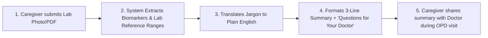

Analyzed 01-problem.md:L1-25
Analyzed 02-research.md:L1-168
Analyzed README.md:L1
Ran list all files in repo

Based on **`docs/01-problem.md`** and the market, clinical, and regulatory findings in **`docs/02-research.md`**, here is the definition of the single core flow, its breakdown into features, and the strict classification into **MVP**, **Later**, and **Never**.

---

## 1. The Single Core Flow

### Core Value Proposition
Empower an anxious family caregiver (the "Nephew" persona) to understand confusing lab numbers in plain language and take 2–3 structured, non-alarmist questions to their doctor—**without the product ever diagnosing, triaging, or prescribing.**

### End-to-End Flow


1. **Submit:** The caregiver sends a photo or PDF of a routine blood report (starting with Metabolic/Lipid panels: Blood Sugar, HbA1c, Cholesterol).
2. **Extract & Demystify:** The system identifies parameters and checks values against **that specific lab’s printed reference ranges** (strictly as a factual match, not a clinical interpretation).
3. **Decode:** Medical jargon is replaced with plain-language definitions (e.g., *“HbA1c” $\rightarrow$ “Your average blood sugar over the last 3 months”*).
4. **Generate Question Guide:** Generates a single-screen, shareable summary card containing a 3-line recap and 2–3 objective questions to ask the treating doctor.
5. **Act:** The caregiver forwards or shows this card to the family doctor at the clinic to facilitate a focused consultation.

---

## 2. Feature & Sub-Feature Breakdown

* **F1: Report Ingestion & Data Extraction**
  * *1.1 Single-Image / PDF Upload via WhatsApp or Web*
  * *1.2 Lab Reference Range & Value Extraction (Sugar & Lipid panels)*
  * *1.3 Multi-panel extraction (CBC, KFT, LFT, Thyroid, Vitamins)*
  * *1.4 Automated ABDM (Ayushman Bharat) Digital Health Locker sync*
* **F2: Plain-Language Biomarker Decoder**
  * *2.1 Static Medical Word Swapper (Biomarker $\rightarrow$ Plain English description)*
  * *2.2 Prescription Shorthand Dictionary (`OD`, `BD`, `PC`, `SOS`)*
* **F3: Objective Range Comparison (Non-Clinical)**
  * *3.1 Factual Range Tagging (*"Within lab range"* vs *"Outside lab range"*)*
  * *3.2 Universal Color-Coded Triage Bands (*Green = Safe, Yellow = Warning, Red = Danger*)*
  * *3.3 Differential Diagnosis & Severity Scorer (*"Likely Diabetic", "Stage 2 CKD"*)*
* **F4: Actionable Summary & Doctor Question Guide**
  * *4.1 Three-Line Summary (Parameters tested, which are outside lab range, doctor prompt)*
  * *4.2 "Questions for Your Doctor" Checklist Generator*
  * *4.3 Treatment & Lifestyle Prescriptions (*"Start 500mg Metformin", "Drink karela juice"*)*
* **F5: Delivery & Caregiver Workflow**
  * *5.1 Shareable One-Page WhatsApp Card / Plain Report Card*
  * *5.2 Vernacular Audio Voice Note (30-sec Hindi/regional explanation)*
  * *5.3 Multi-language Text Translation (Hindi, Tamil, Telugu, Marathi)*
  * *5.4 Automated 3-Day Follow-Up Message (*"Did you see your doctor?"*)*
  * *5.5 Native Mobile App (iOS / Android)*
* **F6: Commercial & Clinical Integration**
  * *6.1 In-app Teleconsultation Upsell / Partner Doctor Booking*
  * *6.2 Medicine / Supplement Ordering Funnel*
  * *6.3 Human-in-the-Loop Doctor Review Network*

---

## 3. Classification: MVP, Later, and Never

### A. MVP (Minimum Viable Product)
*Strictly limited to the minimum elements needed to validate whether caregivers find plain-language explanations and doctor question guides useful.*

| Feature / Sub-Feature | Why It Is in MVP | Challenge / Justification (Why It Cannot Be Cut) |
| :--- | :--- | :--- |
| **F1.1: Single-Image / PDF Ingestion (Restricted to Sugar & Lipid panels)** | Caregivers need an effortless entry point to input standard routine tests (Fasting Sugar, HbA1c, Total Cholesterol, HDL/LDL). | **Challenged:** *Can we use manual form input instead?* **No.** Users will not manually type numerical values, units, and ranges from paper reports; a photo/PDF drop is the bare minimum friction threshold. Scope is strictly capped to two routine panels to avoid OCR sprawl. |
| **F1.2: Factual Lab Range Extractor** | Must parse the specific lab's printed reference range alongside the patient's value. | **Challenged:** *Can we use universal standard ranges?* **No.** As identified in `02-research.md`, standard ranges vary by lab method. Extracting the lab's own stated range prevents false categorization. |
| **F2.1: Static Medical Word Swapper (Sugar & Lipid)** | Translates confusing biomarkers into everyday language (e.g., HbA1c $\rightarrow$ "Average 3-month sugar"). | **Challenged:** *Can we skip this and only show questions?* **No.** The #1 user complaint across reviews is "jargon overload". Without understanding what the biomarker represents, the patient cannot contextualize the report. |
| **F3.1: Factual Value Status Indicator (*"Within lab range"* / *"Outside lab range"* strictly)** | Neutral textual indicator showing whether the number falls outside the lab’s printed bounds. | **Challenged:** *Can the user just read the numbers?* **No.** Elderly patients and non-medical relatives struggle to parse multi-column tables. However, this must remain **purely factual** (no red flags, no "abnormal" or "dangerous" labels). |
| **F4.1: Three-Line Plain Summary** | 1. What was tested.<br>2. What falls outside the lab's printed range.<br>3. Plain reminder to consult the treating doctor. | **Challenged:** *Can we provide a detailed multi-paragraph breakdown?* **No.** Long breakdowns cause anxiety and mimic ChatGPT's failure mode. Three lines deliver maximum clarity with minimum cognitive load. |
| **F4.2: "Questions for Your Doctor" Checklist** | Generates 2–3 specific, vetted questions (e.g., *"Ask your doctor: Does this fasting sugar level require an HbA1c test or dietary adjustments?"*). | **Challenged:** *Can the flow work with just definitions?* **No.** Definitions inform, but do not drive action. Equipping the patient with questions removes consultation anxiety and bridges the communication gap during the OPD visit. |
| **F5.1: Forwardable WhatsApp-Ready Summary Card** | Formatted text/card designed to be forwarded to a parent, sibling, or shown directly to a physician on a phone screen. | **Challenged:** *Can this be a web dashboard?* **No.** In India, family health decisions happen inside WhatsApp threads. Web links introduce login friction and drop-offs. |

---

### B. Later (Post-MVP Enhancements)
*High-value features that improve adoption, retention, and accessibility, but which the core validation flow can function without on Day 1.*

| Feature / Sub-Feature | Why Deferred to Later | Reason MVP Can Work Without It |
| :--- | :--- | :--- |
| **F5.2: Vernacular Audio Voice Notes (Hindi/Regional)** | Crucial for non-English reading elders, but adds speech synthesis (TTS) infrastructure and regional dialect validation overhead. | For the MVP pilot, the primary target is the English-literate urban caregiver (the nephew) who reads the card and verbally explains it to their elders. |
| **F5.3: Multilingual Text Translation** | Expanding into Indian regional languages (Hindi, Tamil, Marathi, etc.) under DPDP Act requirements. | Adds translation QA complexity. MVP can test comprehension with basic English/Hinglish among the initial pilot cohort. |
| **F2.2: Prescription Shorthand Dictionary (`OD`, `BD`, `PC`, `SOS`)** | Educational translation of doctor handwriting shorthand. | Prescriptions involve complex handwritten OCR and doctor-pharmacist workflows that distract from solving the core diagnostic report problem. |
| **F5.4: Automated 3-Day Follow-Up Message (*"Did you see your doctor?"*)** | Targets the consultation delay identified in `01-problem.md`. | Core value (comprehension + doctor questions) is delivered immediately upon report generation. In MVP pilots, follow-ups can be tracked manually or via lightweight pilot surveys. |
| **F1.3: Multi-Panel Biomarker Expansion (CBC, KFT, LFT, Thyroid)** | Expanding biomarker database to full organ profiles and blood counts. | Routine Sugar and Lipid panels represent ~70% of chronic repeat tests. Adding complex hematology increases edge cases before the core model is proven. |
| **F6.3: Human-in-the-Loop Doctor Review Network** | A registered doctor sanity-checks cards before delivery to add trust. | Impractical for a rapid MVP feedback loop and adds significant operational cost. Static template rule engines reviewed beforehand by an advisor achieve initial safety. |
| **F1.4: ABDM / Health Locker Sync** | Automated report fetching from NABL labs via Ayushman Bharat Digital Mission. | Involves heavy regulatory approvals, consent manager integration, and ABHA registration. Manual file upload works for testing demand. |

---

### C. Never (Hard Boundaries: Diagnosis, Treatment, & Regulatory Risk)
*Items that cross into clinical diagnosis, alter medical treatment, trigger CDSCO SaMD Class B licensing, violate Indian telemedicine/consumer protection laws, or destroy user trust.*

| Feature / Sub-Feature | Critical Reason for Rejection | Regulatory / Clinical Violation |
| :--- | :--- | :--- |
| **ANY Medical Diagnosis or Differential Diagnosis Engine** (e.g., *"Your sugar is 130, you have Type 2 Diabetes"*, or listing possible diseases) | **Violates core rule:** *"Anything that would make the product diagnose or change treatment goes into Never."* AI tools catastrophize and trigger severe health panic (as evidenced by ChatGPT reviews in `02-research.md`). | **CDSCO Medical Device Rules (SaMD Class B)** & **Telemedicine Practice Guidelines, 2020:** Only an NMC-registered Medical Practitioner (RMP) can legally diagnose. |
| **ANY Treatment, Medication, or Dosage Advice / Modification** (e.g., *"Take 500mg Metformin"*, *"Stop taking your cholesterol pill"*, or recommending home remedies) | **Violates core rule.** Directly telling a patient what medication to take or modify carries extreme risk of clinical toxicity, organ failure, or mortality. | **NMC Act, 2019 & Drugs and Cosmetics Act:** Unauthorized medical and pharmacological practice. Criminal and civil liability. |
| **Universal Color-Coded Triage Bands (*Green = Safe, Yellow = Warning, Red = Danger*)** | Creates lethal **false reassurance**. A fasting sugar of 105 mg/dL might be "mild" for a 60-year-old, but dangerous gestational diabetes for a pregnant woman. A "Green" band on normal cholesterol can lead an atypical heart disease patient to skip their checkup. | **Consumer Protection Act, 2019 (Deficiency of Service / Negligence)** and **CDSCO Class B Clinical Decision Support** mandates. |
| **Prescription Appropriateness / Dosage Validation** (e.g., evaluating if a prescribed medicine is correct or suggesting alternatives) | Software judging whether a doctor's prescription is appropriate oversteps the clinical discretion of the treating physician and invites malpractice lawsuits. | **Telemedicine Practice Guidelines, 2020:** Intermediary software cannot evaluate physician clinical judgment. |
| **Commercial Teleconsultation & Drug Upselling Funnels** (e.g., pushing partner tele-doctors or Ayurvedic supplements when an abnormal result appears) | Research proves this is the #1 reason patients distrust digital health apps (Tata 1mg, PharmEasy complaints). Patients perceive health warnings as predatory sales funnels. | Destroys clinical credibility and violates DPDP Act purpose limitation safeguards. |
| **Native Mobile App (iOS / Android)** | Patients take diagnostic tests quarterly or semi-annually; they will not download or maintain a standalone mobile app for occasional use. Adds app-store friction and overhead. | Product failure pattern: heavy CAC with 90%+ 30-day churn for single-utility health apps. |

---

## 4. Summary of MVP Scrutiny & Decisions

```
               [ User Submits Lab Report (Sugar / Lipid) ]
                                   │
                                   ▼
                   [ Extractor & Jargon Decoder ]
                   (Factual definitions, no diagnosis)
                                   │
                                   ▼
        [ 3-Line Summary + "Questions for Your Doctor" Card ]
         (No color triage bands, no treatment advice, no ads)
                                   │
                                   ▼
             [ Delivered via Forwardable WhatsApp Card ]
```

* **What was challenged and removed from MVP:**
  1. *Color-coded bands (Green/Yellow/Red):* Cut completely (**Moved to Never**) due to CDSCO SaMD Class B liability and false reassurance risks.
  2. *Prescription decoder:* Cut from MVP (**Moved to Later**) to keep the initial product purely focused on blood test reports.
  3. *Voice notes / vernacular audio:* Cut from MVP (**Moved to Later**) to validate English-literate caregiver workflows before scaling audio pipelines.
  4. *Automated 3-day follow-up bots:* Cut from MVP (**Moved to Later**) to keep the pipeline completely stateless and privacy-first on launch.
* **The Result:** A clean, legally compliant educational utility that solves the caregiver's real problem—understanding what was tested and knowing what to ask the doctor—without crossing into medical practice.