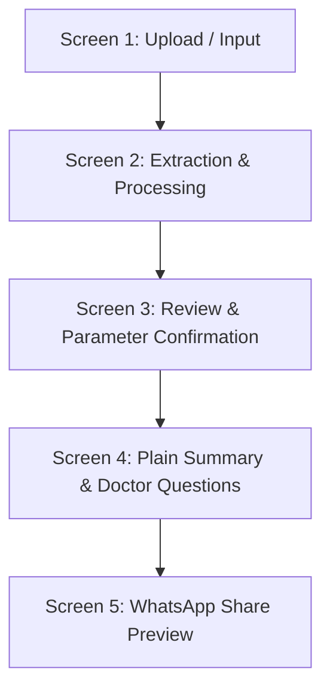

# Design Specification & UI Architecture for ReportSaathi

**Document Reference:** `docs/04-design.md`  
**Based on:** `docs/03-scope.md`, `docs/02-research.md`, and `docs/01-problem.md`  
**Target Hardware & Demographic:** Older users (50–75 years) and family caregivers on low-cost Android smartphones (e.g., Redmi 9A, Samsung Galaxy M04; 360×640dp viewport, Android Go, low RAM/GPU) operating in multi-script Indian linguistic environments (Devanagari, Dravidian, and basic conversational English).

---

## 1. Screen Inventory & State Machine (Core Flow)

The core flow consists of five focused screens designed as a sequential, single-column workflow with zero login friction:



---

### Screen 1: Report Ingestion & Capture (`Screen-01-Upload`)
* **Primary Objective:** Allow an anxious caregiver or older user to submit a blood test photo or PDF within 5 seconds without account creation.
* **Core Elements:** Top branding app bar with bilingual subtitle, supported test notice banner (Sugar & Cholesterol), large camera capture card (56dp touch target), secondary file/PDF picker, DPDP-compliant privacy guarantee card.

| State | Visual & Functional Behavior |
| :--- | :--- |
| **Default** | Big prominent camera button with high-contrast icon; clear helper text: *"Hold phone steady under bright light"*; subtle list of supported panels: *Fasting Blood Sugar, HbA1c, Lipid Profile*; primary CTA reads *"Take Photo of Blood Report"* (56dp height). |
| **Empty** | No image captured yet. Upload button is highlighted with an inviting pulsing border; the primary *"Continue"* CTA is disabled (subtle slate outline) until a valid file or photo is provided. |
| **Loading** | User snapped photo or selected PDF. A native spinner and progress indicator appears: *"Compressing image (1.2 MB $\rightarrow$ 180 KB)..."* with a *"Cancel"* text button. Prevents UI thread freezing on low-RAM devices. |
| **Error** | Triggered by unreadable blur, low lighting, or file > 10MB. Card turns to warm amber (not alarming red): *"Photo is too blurry to read numbers clearly. Please retake under direct light."* Displays a visual tip card showing good vs bad photo framing. |

---

### Screen 2: Processing & Extraction (`Screen-02-Processing`)
* **Primary Objective:** Keep user informed and calm while optical character recognition (OCR) and jargon decoding occur in memory.
* **Core Elements:** Calming circular progress animation, multi-step progress indicators, reassuring educational micro-copy to reduce health anxiety.

| State | Visual & Functional Behavior |
| :--- | :--- |
| **Default / Active** | Progress animation running smoothly at 60fps (CSS-only, low CPU impact). 3 sequential status pings with checkmarks:<br>1. *Reading lab values and units...* [Done]<br>2. *Checking lab's printed reference range...* [Active]<br>3. *Translating medical words to everyday language...* [Pending] |
| **Empty** | Initial 500ms handshake state where skeleton loader pulses before progress begins. |
| **Loading** | Active processing state with elapsed timer and calming reassurance: *"Taking 5–8 seconds to accurately decode your lab parameters..."* |
| **Error** | Triggered if uploaded file is unsupported (e.g., an X-ray, ECG trace, handwritten doctor prescription, or unreadable document): *"We couldn't detect blood test values in this file. ReportSaathi currently works only for blood sugar and cholesterol reports."* Provides a *"Try Another Photo"* button. |

---

### Screen 3: Verification & Confirmation (`Screen-03-Review`)
* **Primary Objective:** Human-in-the-loop verification where the caregiver confirms that extracted numbers match the paper report before seeing the summary, eliminating automated OCR liability.
* **Core Elements:** Side-by-side snippet preview of original photo alongside extracted parameters, one-tap number editor, confirmation CTA.

| State | Visual & Functional Behavior |
| :--- | :--- |
| **Default** | Card listing extracted tests (e.g., *Fasting Glucose: 114 mg/dL \| Lab Range: 70–99*). Next to each number is a small *"Edit"* pencil icon. Prominent green CTA: *"Numbers Match My Report $\rightarrow$"*. |
| **Empty** | Partial extraction where only 1 biomarker was detected: *"We detected Fasting Blood Sugar, but could not detect HbA1c. Was HbA1c on this page?"* with options to add manually or proceed. |
| **Loading** | Updating extracted values if user manually edited a digit or re-scanned a cropped region. |
| **Error** | Lab reference range was cropped or unreadable on the physical paper: *"We couldn't find the reference range for Cholesterol on your paper. Please tap here to enter the range printed on your report."* |

---

### Screen 4: Plain Summary & "Questions for Your Doctor" (`Screen-04-Summary`)
* **Primary Objective:** Core value delivery! Delivers plain-language explanations, a 3-line summary, and actionable questions for the doctor—**strictly without diagnostic labels or red traffic lights**.
* **Core Elements:** 3-line summary banner, decoded biomarker cards with everyday definitions in English & Hindi, factual range tags (*"Outside lab printed range"*), "Questions for Your Doctor" checklist card, prominent statutory disclaimer, sticky WhatsApp share button.

| State | Visual & Functional Behavior |
| :--- | :--- |
| **Default** | High-contrast card view: 3-line summary at top; individual biomarker cards explaining what each test measures; green-tinted *"Questions for Your Doctor"* card with 2 actionable questions; sticky bottom CTA: *"Share Card to WhatsApp"* (56dp height). |
| **Empty** | All tested parameters fall within the lab's printed range. Neutral, reassuring educational card: *"All tested markers are within your lab's printed reference interval. Keep this card handy to discuss your routine health checkup with your doctor."* |
| **Loading** | Generating shareable image card or formatting vernacular text preview. Skeleton shimmer over question blocks. |
| **Error** | Web Share API unsupported or clipboard permissions denied: Displays a fallback card with a pre-formatted text box and a clear *"Tap to Copy Summary Text"* button. |

---

### Screen 5: WhatsApp Share Preview Modal (`Screen-05-Share`)
* **Primary Objective:** Let the caregiver inspect the exact card that will be sent to their family group or doctor before forwarding.
* **Core Elements:** 16:9 high-contrast card preview, direct *"Send to WhatsApp"* button, fallback *"Copy Plain Text"* button, language selector (English / Hindi).

| State | Visual & Functional Behavior |
| :--- | :--- |
| **Default** | Clean image card preview showing the 3-line summary, biomarker definitions, and doctor questions formatted for mobile screen sharing; large green *"Send on WhatsApp"* button. |
| **Empty** | N/A (modal opens only when summary payload exists). |
| **Loading** | Compressing card image and initiating Android WhatsApp intent. |
| **Error** | WhatsApp not installed or intent failed: Automatically copies formatted text to clipboard and displays toast: *"Summary copied! You can paste it into any chat app or SMS."* |

---

## 2. Review of Reference Solutions & Visual Evidence

Visual references illustrating design patterns to borrow and avoid have been generated and archived in `docs/references/`:

### Reference 1: Traditional Diagnostic Lab Reports (Dr Lal / Agilus / Metropolis)
* **Visual Reference:** [01-traditional-lab-report.png](file:///c:/Users/SAANVI%20V%20SHETTY/reportsaathi/docs/references/01-traditional-lab-report.png)
* **What to Borrow:**
  * **Source traceability:** Always show the lab name, patient name, and sample date so the doctor knows the numbers are genuine.
  * **Explicit reference intervals:** Display the exact biological reference interval printed by that specific testing machine.
* **What to Avoid:**
  * **Dense, tabular data sheets:** 8pt to 9pt fonts in multi-column tables designed for pathologists, not patients.
  * **Intimidating clinical codes:** Showing confusing acronyms (`HPLC`, `Hexokinase`) with zero explanation of daily relevance.
  * **Bold red asterisks (`*H*` / `*CRITICAL*`):** Triggers immediate physiological panic without providing context or urgency guidance.

---

### Reference 2: Pharmacy & Telehealth Aggregators (Tata 1mg / PharmEasy / Apollo 24|7)
* **Visual Reference:** [02-pharmacy-upsell-pattern.png](file:///c:/Users/SAANVI%20V%20SHETTY/reportsaathi/docs/references/02-pharmacy-upsell-pattern.png)
* **What to Borrow:**
  * **Clean card-based mobile layout:** Grouping test results into bite-sized, rounded card containers.
  * **Simple touch interactions:** Large buttons with clear visual hierarchy.
* **What to Avoid:**
  * **Predatory upselling funnels:** Weaponizing abnormal lab values to push ₹499 doctor calls or Ayurvedic cholesterol capsules.
  * **Commercial conflict of interest:** Monetizing fear destroys user trust and compromises patient safety.
  * **Fake urgency banners:** Countdown timers (*"Doctor available for 5 mins"*) that induce unnecessary panic.

---

### Reference 3: General AI Chatbots & Symptom Checkers (ChatGPT / Ada Health)
* **Visual Reference:** [03-ai-chat-anxiety-pattern.png](file:///c:/Users/SAANVI%20V%20SHETTY/reportsaathi/docs/references/03-ai-chat-anxiety-pattern.png)
* **What to Borrow:**
  * **Conversational plain language:** Translating medical terminology into clear everyday speech.
* **What to Avoid:**
  * **Catastrophizing & cyberchondria:** Listing rare fatal conditions (lymphoma, pancreatic neoplasms) for minor routine variances.
  * **Diagnostic overreach:** Outputting conclusive statements (*"You have Diabetes Mellitus"*), which violates CDSCO SaMD and NMC regulations.
  * **Exhaustive wall of text:** Long essays that overwhelm elderly users and increase cognitive friction.

---

### Reference 4: Family WhatsApp Groups & Chat Messaging Workaround
* **Visual Reference:** [04-whatsapp-card-reference.png](file:///c:/Users/SAANVI%20V%20SHETTY/reportsaathi/docs/references/04-whatsapp-card-reference.png)
* **What to Borrow:**
  * **Native forwardability:** Formatting outputs specifically for WhatsApp cards and status updates that family elders can read.
  * **Human-in-the-loop validation:** The nephew reviews the card before sending it to elderly parents.
  * **Multimodal audio companions:** Short 30-second localized voice notes to assist non-reading or visually impaired elders.
* **What to Avoid:**
  * **Unverified medical advice:** Family members forwarding dangerous home remedies (bitter gourd juice for sugar > 200).
  * **Doctor relative burnout:** Sending disorganized, blurred photos late at night without structured clinical context.

---

### Reference 5 & 6: ReportSaathi Production Screen Mockups
* **Upload Screen Mockup:** [05-reportsaathi-screen-upload.png](file:///c:/Users/SAANVI%20V%20SHETTY/reportsaathi/docs/references/05-reportsaathi-screen-upload.png)
* **Summary & Doctor Questions Screen Mockup:** [06-reportsaathi-screen-summary.png](file:///c:/Users/SAANVI%20V%20SHETTY/reportsaathi/docs/references/06-reportsaathi-screen-summary.png)

---

## 3. Design Direction for Low-Cost Android, Older Eyes & Indic Scripts

### 1. Layout & Viewport Architecture
* **Target Viewport Baseline:** 360×640dp (scalable up to 412×915dp) representing budget Android handsets running Android 10–14 (Go Edition).
* **Single-Column Vertical Stack:** Zero horizontal tabs, zero nested horizontal carousels, and zero split-screen layouts. Every screen scrolls in one predictable vertical direction.
* **Thumb Zone Anchoring:** All primary interactive controls (Camera capture, Confirm, Share to WhatsApp) are placed in the bottom 45% of the viewport (the physiological "Thumb Zone") for comfortable one-handed use by older users.
* **Performance Budget:** 
  * Total initial bundle size $< 200\text{ KB}$ (instant load on 3G/unstable 4G).
  * Zero heavy JavaScript frameworks or WebGL rendering; pure semantic HTML and CSS card containers.
  * Fast First Contentful Paint (FCP) under 1.2 seconds on budget MediaTek/Unisoc processors.

---

### 2. Typography & Script Handling

```
+-----------------------------------------------------------------------+
|  Primary Display: 18–20sp Bold (High Contrast Navy #0F172A)           |
|  Section Header:  14–16sp Semi-Bold (Letter spacing +0.5px)           |
|  Body Text:       16sp Regular (Line height: 1.55x, Deep Charcoal)    |
|  Subtext / Meta:  13–14sp Regular (Minimum size allowed anywhere)     |
+-----------------------------------------------------------------------+
```

* **Font Stack:** System-native sans-serif prioritized for multilingual rendering:  
  `system-ui, -apple-system, 'Noto Sans Devanagari', 'Noto Sans Tamil', 'Noto Sans Telugu', Roboto, sans-serif`.
* **Sizing for Older Eyes:** Minimum body font size is **16sp** (never below 14sp for auxiliary metadata). All typography scales gracefully up to **1.3x system accessibility font scaling** without breaking container boundaries.
* **Vertical Diacritic Clearance (Indic Scripts):** Devanagari and Dravidian scripts feature top vowel marks (*ऊपर की मात्राएँ जैसे 'ी', 'े', 'ै'*) and bottom conjuncts (*नीचे की मात्राएँ जैसे 'ु', 'ू', 'ृ'*). Line-height is strictly set to **1.55x to 1.6x** with `padding-top: 4px` on text blocks to prevent diacritic clipping.
* **Long Compound Word Resilience:** Indian languages and medical translations produce long compound words (e.g., *'मधुमेह'*, *'कोलेस्ट्रॉल'*, *'हाइपरग्लाइकेमिया'*, *'रक्त शर्करा'*). To eliminate horizontal overflow and awkward text breaks on 360dp screens:
  ```css
  overflow-wrap: break-word;
  word-break: normal;
  hyphens: auto;
  ```

---

### 3. Colour Palette (Anti-Alarmist & WCAG AAA Compliant)

| Color Name | Hex Code | Purpose & Usage | Accessibility Compliance |
| :--- | :--- | :--- | :--- |
| **Deep Slate Navy** | `#0F294A` | Top app bars, 3-line summary containers, primary branding. | Contrast ratio 14.2:1 against white (WCAG AAA). |
| **Card White** | `#FFFFFF` | Biomarker cards, question boxes, main readable surfaces. | Maximum contrast against text. |
| **Calm Medical Blue** | `#0284C7` | Primary buttons, active touch targets, focus outlines. | Contrast ratio 4.6:1 against white; clear visual affordance. |
| **Doctor Question Green** | `#F0FDF4` / `#166534` | Background and text for "Questions for Your Doctor" card. | Conveys constructive action and forward momentum; ratio 8.1:1. |
| **Neutral Out-of-Range Tag** | `#FEF3C7` / `#92400E` | Calm Ochre tag for numbers outside printed lab range. | **Replaces alarming red.** Flags attention without inducing fear. |
| **Subtle Slate Gray** | `#64748B` | Reference intervals, secondary metadata, borders. | Minimum 4.5:1 ratio against card backgrounds. |

> [!IMPORTANT]
> **The Anti-Alarmist Rule:** Bright red (`#EF4444`) and neon traffic-light green (`#22C55E`) are **strictly prohibited** on report values. Red triggers immediate spike in patient anxiety and white-coat hypertension; green creates dangerous false reassurance for atypical patients. Out-of-range values are marked with a calm, neutral Ochre tag: *"Outside Lab Printed Range"*.

---

### 4. Spacing & Physical Touch Targets
* **Touch Target Standards:** Primary action buttons feature a minimum height of **56dp** with a full-width container (leaving 16dp side margins) to comfortably accommodate unsteady or older thumbs.
* **Card Padding:** 16dp lateral screen margins; 20dp internal padding inside every card to ensure text never touches container edges.
* **Cognitive Breathing Room:** Minimum **24dp vertical spacing** between major content cards (Summary vs Decoded Biomarkers vs Doctor Questions) to prevent visual crowding.

---

### 5. Tone of Voice & Copywriting Rules

```
                      [ RESPECTFUL & DIGNIFIED ]
                                  │
         ┌────────────────────────┴────────────────────────┐
         ▼                                                 ▼
[ CALM & FACTUAL ]                                [ DOCTOR-AFFIRMING ]
- Explains what test measures                      - Equips patient with questions
- Avoids panic & scary words                       - "Show this to your doctor"
- Replaces jargon with plain analogies             - Preserves human clinical role
```

* **Calm & Factual:** Never use catastrophic or dramatic words (*"Dangerous", "Critical", "Alarming", "Sick"*). Use precise, neutral phrasing: *"Your fasting sugar is outside the lab's printed reference range."*
* **Doctor-Affirming:** Always elevate the treating physician as the decision-maker. Frame every insight as a prompt for the clinic visit: *"Ask your doctor if you should adjust your walking routine or repeat this test in 3 months."*
* **Non-Diagnostic:** Strictly avoid diagnostic conclusions (*"You have Type 2 Diabetes"*). Frame as physiological explanation: *"Fasting sugar measures glucose in your bloodstream after 10 hours without food."*
* **Respectful & Bilingual:** Provide bilingual labels (English + Hindi) on key headers (*"Report Summary \| रिपोर्ट सारांश"*) to bridge generational comfort within Indian families.
