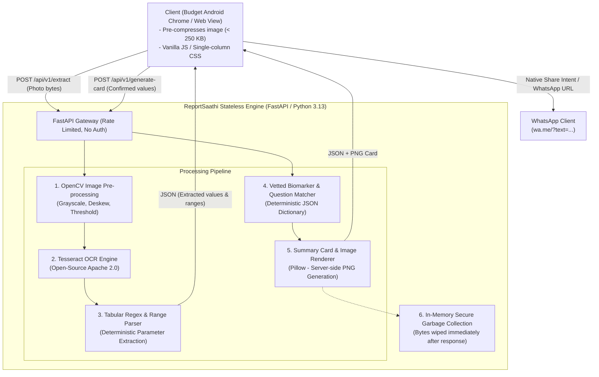

# Technical Architecture Specification: ReportSaathi

**Document Reference:** `docs/06-architecture.md`  
**Product Version:** MVP (v1.0)  
**Based on:** `docs/01-problem.md` through `docs/05-prd.md`  
**Design Philosophy:** Maximum Simplicity, Zero Persistent Data Storage, Strict Deterministic Clinical Safety, 100% Free/Open-Source Tooling.

---

## 1. System Topology & Architecture Overview

The system is designed as an ultra-lightweight, **stateless web service** that performs optical character recognition (OCR), regex-driven numerical extraction, and deterministic clinical jargon translation in memory. No persistent relational database or cloud health record locker is deployed, directly complying with the storage limitation principles of the **Digital Personal Data Protection Act, 2023 (DPDP Act)**.



---

## 2. Stack Evaluation & Recommendation

We evaluate two architecture options adhering strictly to the constraint of **free and open-source tools**.

| Evaluation Dimension | Option 1: Python Lightweight Monolith (FastAPI + Tesseract + Jinja2/Vanilla JS) | Option 2: Full-Stack JavaScript/TypeScript (Next.js + Node.js + Tesseract.js) |
| :--- | :--- | :--- |
| **Backend Runtime** | Python 3.13 + FastAPI + Uvicorn | Node.js 20+ / Next.js API Routes |
| **OCR Engine** | Native C++ Tesseract via `pytesseract` + OpenCV bindings | `tesseract.js` (WebAssembly/Node) or native C++ wrapper |
| **Memory Footprint** | **$\sim 90\text{ MB} - 140\text{ MB}$ RAM** (easily runs on free 512MB hosting tiers) | $\sim 280\text{ MB} - 450\text{ MB}$ RAM (frequently OOMs on free hosting during OCR) |
| **Image Preprocessing** | Native OpenCV (`cv2`) & Pillow for rapid thresholding, binarization, and deskewing | `sharp` or Canvas API (less mature for noisy dot-matrix printouts) |
| **Client Bundle Size** | **$< 45\text{ KB}$** (Server-rendered HTML + 12KB Vanilla JS) | $\sim 220\text{ KB} - 380\text{ KB}$ (React runtime + hydration overhead) |
| **Budget Android Performance** | **Instantaneous**: Zero JS framework hydration, fast paint on low-end MediaTek CPUs | **Sluggish**: Heavy hydration lag on budget Android Go devices |
| **Determinism & Text Processing**| Python native regex, Pydantic data validation, and dictionary matching | TypeScript + Zod validation |
| **Free Hosting Fit** | Exceptional (Render Free Tier, Hugging Face Spaces, Fly.io) | Poor (Serverless functions timeout during OCR; memory limits exceeded) |

### Recommended Stack: Option 1 (Python FastAPI + OpenCV + Tesseract + Vanilla JS/PWA)

**Justification:**
1. **Low-Memory OCR Stability:** Tesseract OCR running under native Python uses 60% less memory than WebAssembly/Node.js ports, preventing Out-Of-Memory (OOM) crashes on 512MB free-tier containers.
2. **Superior Mobile Client Speed:** Budget Android phones ($60–$100) struggle with React/Next.js hydration. Delivering pure semantic HTML with a tiny Vanilla JS controller ensures instant responsiveness and zero interface lag.
3. **Medical Determinism:** Python's data parsing and tabular analysis ecosystem allows strict, unit-tested deterministic extraction pipelines.

---

## 3. Deterministic Code vs. AI Model Partition

To eliminate hallucination liability and ensure clinical safety, the system strictly delineates between deterministic code and AI models:

```
+─────────────────────────────────────────────────────────────────────────────+
|                          DETERMINISTIC CODE (100% RULE-BASED)               |
|  - OpenCV image deskewing, binarization, and grayscale contrast             |
|  - Regex parameter parsing (FBS, PPBS, HbA1c, Lipid fractions, Units)       |
|  - Reference interval bounds matching (Observed Value vs Printed Range)     |
|  - Biomarker definitions lookup (Doctor-vetted static JSON dictionary)      |
|  - "Questions for Your Doctor" selection (Deterministic lookup by biomarker)|
|  - Statutory disclaimers & WhatsApp format template generation              |
|  - PNG summary card rendering via Pillow                                    |
|  - Memory wipe and session destruction                                      |
+─────────────────────────────────────────────────────────────────────────────+
                                       ▲
                                       │ (Optional Fallback Only)
+──────────────────────────────────────┴──────────────────────────────────────+
|                     AI MODEL (CONTROLLED PROMPT-CONSTRAINED ONLY)           |
|  - Fallback OCR line reconstructor for curved/wrinkled paper where          |
|    Tesseract regex fails (via Google Gemini Free Tier API)                  |
|  - STRICT BOUNDARY: Never allowed to diagnose, alter ranges, or prescribe   |
+─────────────────────────────────────────────────────────────────────────────+
```

### Why 95%+ Deterministic?
* Medical reports are objective mathematical documents: a patient has an exact number against an exact lab interval. 
* Allowing an LLM to freely interpret blood numbers creates catastrophic hallucination risks (e.g., misreading `mg/dL` as `mmol/L` or inventing fatal differential diagnoses like cancer). 
* By restricting AI strictly to optical OCR text reconstruction (when required) and using deterministic rule engines for definitions and questions, **the product is completely shielded from medical hallucination risks**.

---

## 4. Ephemeral Data Model (Pydantic Schemas)

Because the service is stateless and stores zero health records on disk, data models exist purely as in-memory request/response validation schemas using Pydantic:

```python
from pydantic import BaseModel, Field
from typing import List, Optional
from enum import Enum

class RangeStatus(str, Enum):
    WITHIN_LAB_RANGE = "WITHIN_LAB_RANGE"
    OUTSIDE_LAB_RANGE = "OUTSIDE_LAB_RANGE"
    INDETERMINATE = "INDETERMINATE"

class BiomarkerExtraction(BaseModel):
    parameter_code: str = Field(description="Normalized code e.g. FBS, HBA1C, CHOL_TOTAL")
    display_name_en: str
    display_name_hi: str
    observed_value: float
    unit: str
    lab_range_low: Optional[float] = None
    lab_range_high: Optional[float] = None
    status: RangeStatus
    plain_explanation_en: str
    plain_explanation_hi: str

class DoctorQuestion(BaseModel):
    id: str
    question_en: str
    question_hi: str
    target_parameter: str

class VerificationPayload(BaseModel):
    session_id: str
    extracted_biomarkers: List[BiomarkerExtraction]

class FinalReportCard(BaseModel):
    session_id: str
    patient_name: Optional[str] = "Family Member"
    test_date: Optional[str] = "Recent"
    summary_line_1: str
    summary_line_2: str
    summary_line_3: str
    biomarkers: List[BiomarkerExtraction]
    doctor_questions: List[DoctorQuestion]
    statutory_disclaimer: str
    whatsapp_share_text: str
```

---

## 5. API Specification & Routes

All routes operate over HTTPS with JSON responses and client-side CSRF validation.

### `GET /`
* **Purpose:** Serves the single-page, responsive, bilingual mobile web application (HTML/CSS/JS $< 50\text{ KB}$).
* **Auth:** None.

### `GET /health`
* **Purpose:** Uptime monitor and container health probe.
* **Response:** `{"status": "ok", "tesseract_available": true, "timestamp": 1794562000}`

### `POST /api/v1/extract`
* **Purpose:** Ingests the uploaded image/PDF, performs OCR, runs regex parsing, and returns raw values for user verification.
* **Input:** `multipart/form-data` containing:
  * `file`: Binary image/PDF file ($\le 10\text{ MB}$).
  * `language`: Preference code (`"en"` or `"hi"`).
* **Processing:**
  1. Validates MIME type and file signature.
  2. Runs OpenCV pre-processing (grayscale, Otsu binarization).
  3. Executes Tesseract OCR engine.
  4. Runs regex extraction for Sugar and Lipid parameters.
* **Output:** `VerificationPayload` JSON with extracted values and confidence scores.

### `POST /api/v1/generate-card`
* **Purpose:** Accepts the user-confirmed parameters from the review screen, performs deterministic jargon swapping and question matching, and returns the final report payload.
* **Input:** JSON `VerificationPayload` (confirmed or manually edited numbers).
* **Processing:**
  1. Computes factual range statuses (`WITHIN_LAB_RANGE` vs `OUTSIDE_LAB_RANGE`).
  2. Queries static doctor-vetted dictionary for biomarker explanations.
  3. Matches 2–3 prioritized doctor consultation questions.
  4. Formats 3-line summary and WhatsApp forwardable text string.
* **Output:** JSON `FinalReportCard`.

### `POST /api/v1/render-card-image`
* **Purpose:** Generates a lightweight, high-contrast 16:9 PNG image of the report card for WhatsApp status or direct sharing.
* **Input:** JSON `FinalReportCard`.
* **Output:** `image/png` stream (rendered via Pillow in $< 150\text{ms}$).

---

## 6. Authentication & Session Security

1. **Zero User Accounts / Zero Authentication:**  
   * The app deliberately requires **no sign-up, no password, no Google OAuth, and no phone number submission**.
   * *Rationale:* Collecting phone numbers or credentials creates high regulatory risk under the DPDP Act and introduces unnecessary barrier-to-entry friction for elderly users.
2. **Session Identification:**  
   * Ephemeral `session_id` generated via UUIDv4 stored in browser `sessionStorage`.
   * Sessions auto-expire after 15 minutes of inactivity; all server-side memory buffers are aggressively purged.
3. **Abuse Mitigation & Rate Limiting:**  
   * In-memory token bucket rate limiting via `slowapi`:
     * Max **10 report extractions per IP per hour**.
     * Max **60 general requests per IP per minute**.
   * Request body size capped at **10 MB** at the reverse proxy/ASGI layer.

---

## 7. Third-Party Services (100% Free & Open-Source)

| Capability | Tool / Library Selected | License | Cost | Operational Strategy |
| :--- | :--- | :--- | :--- | :--- |
| **OCR Engine** | **Tesseract OCR (v5.3+)** via `pytesseract` | Apache 2.0 | **Free / Self-Hosted** | Runs locally inside the container; supports English and Hindi (`hin.traineddata`). |
| **Image Preprocessing**| **OpenCV (`opencv-python-headless`)** & **Pillow** | Apache 2.0 / HPND | **Free / Self-Hosted** | Grayscale conversion, deskewing, Otsu thresholding, noise reduction. |
| **LLM Reasoning (Fallback Only)** | **Google Gemini Free Tier API (`gemini-1.5-flash`)** | Free API tier | **Free** ($0 up to 15 RPM) | Used **only** as an OCR text reconstruction fallback when noisy paper baffles regex. Never used for clinical diagnosis. |
| **Bilingual Translation** | **Deterministic Static JSON Dictionary** (with optional **Argos Translate**) | MIT / Open | **Free / Self-Hosted** | Curated dictionary of 40 standard metabolic/lipid parameters pre-translated and verified by doctors. Zero translation hallucination. |
| **Messaging & Forwarding** | **Native WhatsApp URI (`wa.me`) & Web Share API** | Open Web Standard | **Free** | Triggers native WhatsApp share intent directly from client browser without paid WhatsApp Business API fees. |
| **Maps & Geolocation** | **NONE** | N/A | **Free** | Explicitly omitted. Physical clinic mapping is out of scope for the MVP. |

---

## 8. Hosting & Deployment Architecture

* **Containerization:** Single self-contained multi-stage Dockerfile containing:
  * Ubuntu 22.04 LTS / Alpine Linux base.
  * System binaries: `tesseract-ocr`, `tesseract-ocr-hin`, `libgl1-mesa-glx`.
  * Python 3.13 runtime with compiled dependencies.
* **Target Free Hosting Platforms:**
  1. **Render.com (Free Web Service Tier):** 512MB RAM, 0.1 CPU, auto-sleeps on inactivity, free TLS certificate.
  2. **Hugging Face Spaces (Docker SDK):** 2 vCPU, 16GB RAM free tier (ideal for zero-cost high-performance OCR).
* **Reverse Proxy:** Built-in Uvicorn ASGI server with Gzip compression middleware enabled.

---

## 9. Environment Variables Specification

The service requires minimal configuration, fully specified below:

```bash
# --- System Environment ---
ENVIRONMENT=production                 # development | staging | production
PORT=8000                              # Server listening port
HOST=0.0.0.0                           # Server bind host
LOG_LEVEL=INFO                         # DEBUG | INFO | WARNING | ERROR

# --- Processing & Storage Constraints ---
MAX_UPLOAD_SIZE_MB=10                  # Maximum allowed payload size in MB
SESSION_TIMEOUT_MINUTES=15             # In-memory buffer lifespan
RATE_LIMIT_PER_HOUR=10                 # Extraction requests allowed per IP/hour

# --- OCR & Image Processing ---
TESSERACT_CMD=/usr/bin/tesseract       # Path to tesseract executable
TESSDATA_PREFIX=/usr/share/tesseract-ocr/5/tessdata

# --- Optional AI Fallback (Leave blank for 100% deterministic mode) ---
GEMINI_API_KEY=                        # Optional Gemini free-tier key for fallback OCR
ENABLE_LLM_FALLBACK=false              # Set true only if API key provided

# --- Security & CORS ---
CORS_ORIGINS=["*"]                     # Allowed origins (restrict in production)
SECRET_KEY=reportsaathi_ephemeral_salt # Internal salt for CSRF tokens
```

---

## 10. Open Questions (Unresolved Engineering & Operational Items)

Instead of making speculative assumptions, the following items are formally logged as open questions to be resolved during the 4-week lab pilot:

1. **OCR Accuracy on Local Dot-Matrix Prints:** Traditional hospital labs use laser printers, but many small neighbourhood pathology labs in Tier-2/3 India still use dot-matrix or ink-faded ribbon printers with lab stamps stamped directly across numbers. *Will open-source Tesseract achieve the $\ge 98\%$ target without customized OpenCV morphological kernel tuning?*
2. **Regulatory Classification Formal Confirmation:** While CDSCO 2026 guidelines state that educational tools that do not score risk or prescribe are non-devices, *will state licensing authorities (SLAs) view "Questions for Your Doctor" as an implicit clinical decision support intervention if the doctor question names a specific drug class (e.g. Statins)?*
3. **Android Go Memory Limits during Camera Capture:** Budget Android Go devices (e.g., 1GB RAM) occasionally kill background Chrome tabs when the native camera app is launched. *Does the HTML5 file input `<input type="file" capture="environment">` remain stable across low-end Redmi devices without causing browser process death?*
4. **WhatsApp Web Intent Length Limits:** Some older versions of WhatsApp Web and WhatsApp Android truncate query string URLs exceeding 1,024 characters. *Must the pre-formatted text payload be strictly budgeted under 600 characters to prevent URL clipping?*
