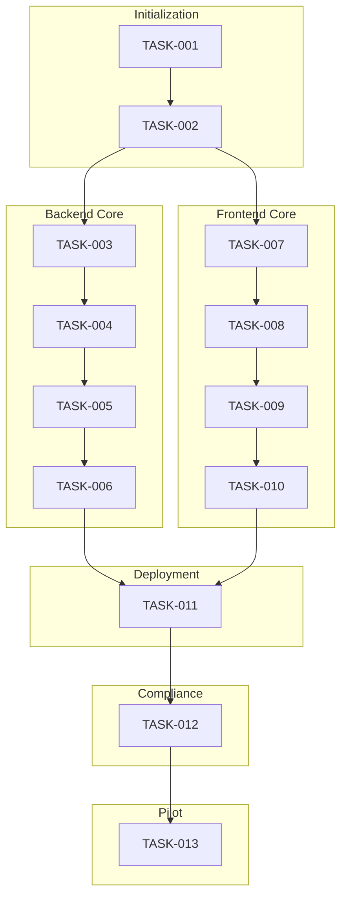

# Task List – Walking Skeleton

**Goal:** Deliver a minimal, end‑to‑end runnable system (backend + frontend) that demonstrates the core health‑check flow, infrastructure, and testing pipeline. Each task is sized for a single Pull Request.

---

## Ordered Tasks

| ID | Title | Owner | Requirements (IDs) | Tests | Dependencies | Definition of Done | Human Approval |
|----|-------|-------|--------------------|-------|--------------|--------------------|----------------|
| **TASK‑001** | Initialise repository & CI workflow | DevOps | – | CI passes (lint, type‑check, unit tests) | None | Repo contains `.github/workflows/ci.yml`, `ruff.toml`, `mypy.ini`; GitHub Actions run on every push and report success. | – |
| **TASK‑002** | Add shared contract schema & TypeScript types | Backend / AI | – | Schema validation test (`backend/tests/test_schemas.py`) passes | TASK‑001 | `shared/schemas/contract.json` and `shared/types/index.ts` generated from API contract; exported via package `shared`. | – |
| **TASK‑003** | Implement backend config & DB layer | Backend | – | DB connection unit test (`backend/tests/test_database.py`) passes | TASK‑001 | `backend/app/config.py` reads env vars with defaults; `backend/app/database.py` creates SQLite DB and provides `engine` and session utilities. | – |
| **TASK‑004** | Seed database with system status & create medical dictionary (static list) | Backend | – | Seed test passes (record exists) | TASK‑003 | On app startup, a `service_status` row is inserted; a JSON file `shared/data/medical_dictionary.json` is added (reviewed by medical expert). | ⚠️ Human Approval Required |
| **TASK‑005** | Add health endpoint (GET `/api/health`) | Backend | TASK‑002, TASK‑003 | Integration test (`backend/tests/test_health.py`) returns JSON with `status`, `db_value`, `timestamp`. | TASK‑002, TASK‑003 | FastAPI route returns health info plus DB‑derived value; OpenAPI spec updated. | – |
| **TASK‑006** | Create Dockerfile for backend (multi‑stage, install OCR binaries) | DevOps | TASK‑005 | Docker build step in CI succeeds | TASK‑005 | `Dockerfile` builds backend image, copies code, runs migrations, exposes port 8000, includes healthcheck. | – |
| **TASK‑007** | Setup frontend skeleton (HTML + CSS + JS) | Frontend | – | Smoke test (`frontend/tests/smoke.test.js`) passes | None | `frontend/public/index.html` loads, `frontend/public/app.js` fetches `/api/health` and displays `status`, `db_value`. | – |
| **TASK‑008** | Wire frontend to backend (proxy config) | Frontend | TASK‑005 | End‑to‑end test (Cypress‑style) passes | TASK‑005, TASK‑007 | Development server proxies `/api/*` to backend container; page shows live health data. | – |
| **TASK‑009** | Add frontend lint & unit tests | Frontend | – | Lint passes (`npm run lint`) | TASK‑007 | ESLint/Prettier config added; test suite verifies DOM elements have expected IDs. | – |
| **TASK‑010** | CI integration of frontend build & tests | DevOps | TASK‑007, TASK‑009 | CI workflow runs `npm ci`, builds, runs tests | TASK‑001, TASK‑007, TASK‑009 | `.github/workflows/ci.yml` includes steps for Node, publishes artifact on success. | – |
| **TASK‑011** | Deploy backend & frontend to staging (Docker Compose) | DevOps | TASK‑006, TASK‑010 | Staging deployment health check passes | TASK‑006, TASK‑010 | `docker-compose.yml` launches backend and frontend containers; `docker compose up` starts services without errors. | – |
| **TASK‑012** | Add DPDP compliance audit checklist | AI / Legal | – | Checklist reviewed manually | None | `docs/06b-safety-rules.md` updated with audit items; task creates GitHub Issue for audit. | ⚠️ Human Approval Required |
| **TASK‑013** | Conduct pilot release & user acceptance testing | All | TASK‑011 | Acceptance criteria from `docs/07-test-plan.md` executed | TASK‑011 | Release tag created; pilot participants test on low‑cost Android devices; feedback collected. | ⚠️ Human Approval Required |

---

## Parallelism Overview

---

## Open Questions (to be resolved before next sprint)
1. **Production database:** Will SQLite be replaced with PostgreSQL/Cloud SQL?  
2. **OCR binary availability on target hosting (Render, Railway, etc.)?**  
3. **Static‑site hosting for the frontend:** Separate CDN or bundled in backend container?

---

*All tasks are scoped to a single PR, include clear owners, and have explicit DoD. Human‑approval flags are highlighted with ⚠️.*
